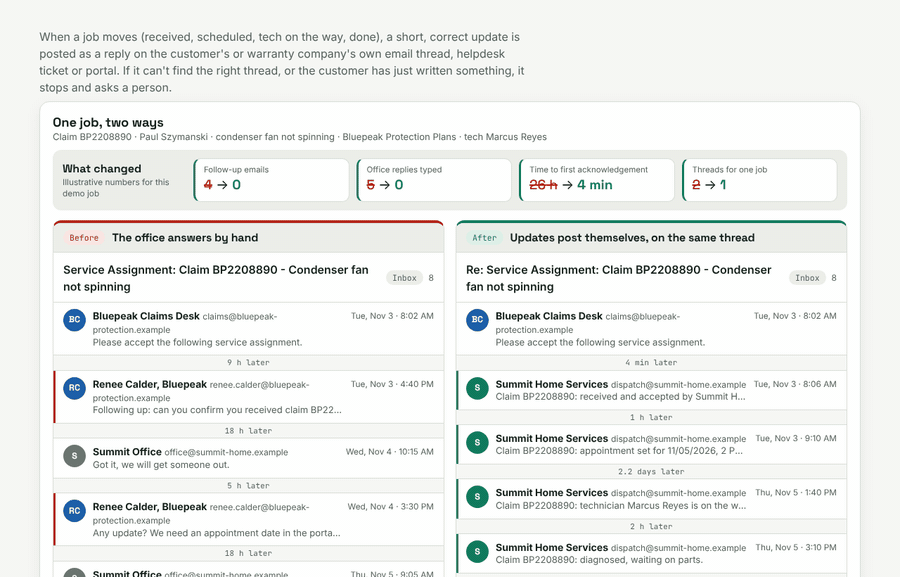
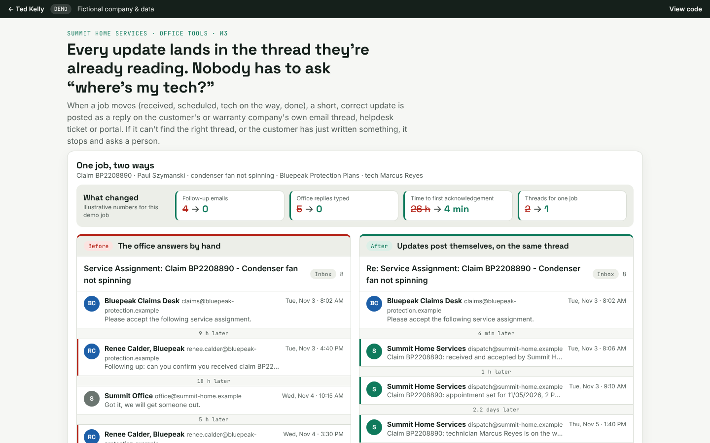

# Status Updates on the Original Thread (M3)

When a job moves, a short, correct update is posted as a reply on the thread the customer or warranty company is already reading, so nobody has to ask "where's my tech?"

**Try it:** https://tedkelly.dev/projects/thread-updates/



## The problem

Customers keep asking where their job is.

A warranty company sends a work order. The office is busy, so the first reply goes out a day later. The warranty company emails again: "any update?" The homeowner calls them, then starts a new email thread with you: "Where is the technician??" Someone in the office types a quick answer on one thread but not the other. The warranty company's portal still says "Assigned" five days later. Every one of those emails is a person stopping what they're doing to answer a question the job sheet already knows.

## What it does

- **Watches the jobs sheet.** When a job's status changes (received, scheduled, tech on the way, completed, waiting on parts, rescheduled), it writes the update.
- **Posts it on the original thread.** A reply on the vendor's or homeowner's own email thread (same `Re:` subject, threaded with `In-Reply-To`), a public comment on their helpdesk ticket, or a note on their vendor portal.
- **Writes it the way each reader wants it.** Warranty companies get the claim # first and dates in their format (`11/09/2026` for one, `2026-11-09 13:00` for another). Homeowners get plain, friendly sentences with the tech's name and the time window.
- **Attaches the completion report** when the job is done.
- **Stops and asks a person** when it isn't sure: no matching thread, two possible threads, or an unread message from the customer.

The demo has six real jobs from the shared Summit data, across Bluepeak (email thread), Northstar (helpdesk ticket), Harbor (vendor portal note) and a direct homeowner. Press the next status and watch the reply appear on that job's thread, with every check it ran.

## Before and after

The demo opens with one job (claim BP2208890, a condenser fan) told twice:

| | Before | After |
|---|---|---|
| Follow-up emails from the vendor and homeowner | 4 | 0 |
| Replies the office typed by hand | 5 | 0 |
| Time to first acknowledgement | 26 hours | 4 minutes |
| Threads for one job | 2 (the homeowner started a new one) | 1 |
| Vendor portal | Still "Assigned" after 5 days | Updated at every step |
| Each update says | "Scheduled for today 2-4." | Claim #, tech name, window or ETA, what was done, report attached |

These numbers are illustrative, counted from the two demo threads.

## The safety rules it follows

1. **Shadow mode first.** On a first visit every update is created as a draft on the right thread and logged as "would send". Nothing goes out. In a real install you read the drafts for a week, then switch it on.
2. **Right thread or no send.** It finds the thread by the thread ID saved when the request came in, or by the claim # (from the vendor's own domain), and checks the customer or vendor matches. If there's no match, or more than one, the update goes to **Needs a person** with the full context: what it searched for, what it found (including a near-miss claim number), and the update it was going to post. It never starts a new thread and never guesses. Try SH-1049 and SH-1061.
3. **Never twice.** Each update has a key: job + status + appointment window. If the same event arrives again (a double edit, a retried webhook), it's logged "already sent, skipped". Try **Same event again**.
4. **Quiet hours for homeowners.** No emails to homeowners between 8 PM and 7 AM. They're queued and go out at 7:00 AM, after one more check. Warranty companies get updates around the clock. Try SH-1042 with **Jump to 8:50 PM**.
5. **Customer replied? Pause.** If the customer or vendor has written something nobody has read yet, it won't post a cheery update on top of a complaint. It pauses that thread and flags it to a person, who can read it and release the update or handle it by hand. Try **Customer replied**, then the next status.
6. **Approve the first 5.** A new vendor template needs a person's OK for its first 5 live sends. Try SH-1043 (Harbor) with shadow mode off.
7. **Everything is logged.** Every event, draft, send, skip and hand-off goes in the activity log with a timestamp and the checks it ran. The counters show updates sent, drafts in shadow, held for a person, duplicates skipped and updates waiting for 7 AM.

## What it costs to run

- **Google Apps Script version** (`apps-script/thread-updates.gs`): $0 per update. Apps Script and the Gmail API are included with Google Workspace, within Google's daily quotas, which is plenty for a few dozen updates a day.
- **Optional AI rewrite:** templates are the default and need no AI. If you want a model to smooth the wording, it's a fraction of a cent per update.
- **n8n version** (`n8n/m3-thread-updates.json`): self-hosted on a small server (from about $5 a month), or n8n Cloud on a monthly plan. Pricing changes, so check n8n's current pricing page.
- **Helpdesk and vendor portals:** comments go through their own API with the login you already have.

Ted builds it for a fixed price. His monthly retainer covers running it: keeping an eye on the Needs a person queue, adding templates when you take on a new vendor, and fixing what breaks.

## For developers

- `index.html`, `app.css`: the page (shared tokens come from `shared/demo.css`).
- `engine.js`: the engine (`window.Threads`). Thread matching, idempotency keys, quiet hours, the customer-replied pause, approve-the-first-5, the per-vendor templates, the pipeline (`runEvent`) and the before/after story. It has no DOM code, so you can run it in Node:

  ```js
  global.window = global;
  require('shared/data.js');
  const T = require('./engine.js');
  const st = T.createState({ shadow: false });
  console.log(T.runEvent(st, 'SH-1044', 'received').message.body);   // posted on the Bluepeak thread
  console.log(T.runEvent(st, 'SH-1049', 'received').personItem.why); // no thread: goes to a person
  ```
- `tests/engine.test.js`: 69 checks with no test framework. Run `node tests/engine.test.js`.
- `app.js`: the UI. Add `?reset=1` to the URL to start fresh, or `?shadow=0` to start with shadow mode off.
- `apps-script/thread-updates.gs`: a working Apps Script. A time-driven trigger checks the Jobs sheet every 5 minutes, compares each row with its "Last Notified Key", finds the original thread (saved thread ID, or `GmailApp.search` by claim #), and replies with `thread.reply()`, or `createDraftReply()` in shadow mode. It honors quiet hours, pauses when the newest message is from the customer and unread, asks for approval on new templates, logs every result and emails a person on any error.
- `n8n/`: an importable n8n workflow plus a [README](n8n/README.md).

The demo saves its state (jobs, threads, queues, log and the shadow-mode setting) in `localStorage`, wrapped in try/catch so it still works in a private window, just without saving.



## Built with

Plain HTML, CSS and JavaScript, with no framework and no build step. It's hosted on GitHub Pages. The production versions use Google Apps Script with Gmail and Google Sheets, or n8n.

## Note

Summit Home Services, Northstar Home Warranty, Bluepeak Protection Plans and Harbor Appliance Care are fictional, and so is every name, address, claim number and ticket number in this demo. Nothing is sent anywhere: the threads, the clock and the pipeline all run in your browser.

## Run it locally

No install or build step. Clone the repo and open `index.html` in a browser, or serve the folder:

```bash
git clone https://github.com/TedKelly561/thread-updates.git
cd thread-updates
python3 -m http.server 8000   # then open http://localhost:8000
node tests/engine.test.js     # run the engine checks
```

`shared/data.js` holds the fictional company (Summit Home Services) shared by every demo. The Apps Script version is in [`apps-script/`](apps-script/) and the n8n workflow in [`n8n/`](n8n/).

## More from Ted Kelly

- [Work Order Intake (M1)](https://github.com/TedKelly561/work-order-intake): messy email → checked service ticket
- [Health Check & Daily Digest (M2)](https://github.com/TedKelly561/daily-digest): know every morning that your automations ran
- [Quote Builder](https://github.com/TedKelly561/quote-builder) · [Dispatch Board](https://github.com/TedKelly561/dispatch-board) · [Owner's KPI Dashboard](https://github.com/TedKelly561/kpi-dashboard)

## About

Built by **Ted Kelly**: I build automations for field service, repair and warranty businesses, switch them on safely, and keep them running. See the [safety method](https://tedkelly.dev/safety/) or book a free 20-minute call at **[tedkelly.dev](https://tedkelly.dev)**.

## License

[MIT](LICENSE). All companies, people, addresses and claim numbers in this demo are fictional.
